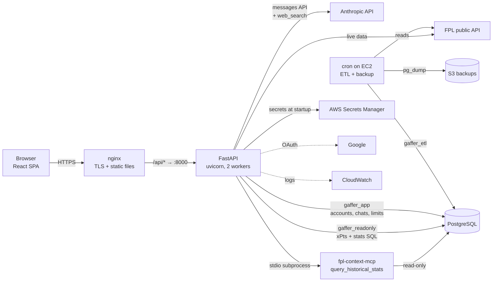
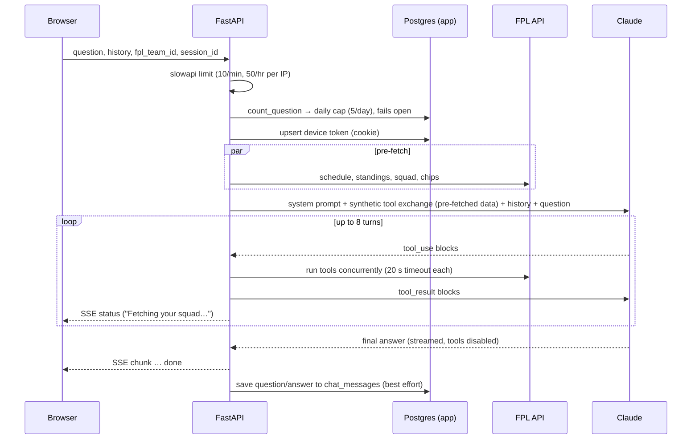
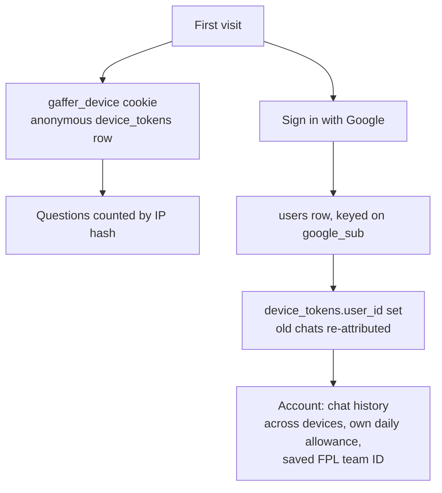

# The Gaffer — Architecture

How the system fits together, and why it was built this way. Written against the code at
v0.107.0. Where a claim comes from `CLAUDE.md` rather than the code, or I could not verify
it, it is marked **(unverified)**. Section 12 lists known gaps.

Contents: 1 Overview · 2 System context · 3 Components · 4 Request lifecycle · 5 Data
architecture · 6 Identity & auth · 7 Cost & abuse controls · 8 Security model · 9
Infrastructure & delivery · 10 Observability · 11 Design decisions & trade-offs · 12 Known
gaps · 13 Where to change what

---

## 1. Overview

The Gaffer answers Fantasy Premier League (FPL) questions in natural language ("should I
captain Salah?", "when should I Bench Boost?"). A React chat UI sends the question to a
FastAPI backend, which runs a **Claude tool-use loop**: Claude decides which tools to call,
the backend executes them against live FPL data, a historical Postgres database and web
search, and Claude streams back a verdict-first answer.

Design goals, in priority order:

1. **Answers grounded in data, not model memory.** Training data is a season stale; every
   fixture, club and player claim must come from a tool result.
2. **Cheap to run.** One small server, one model, prompt caching, a free-tier cap.
3. **Simple to operate.** One box, one database, no queues, no containers.
4. **Private by default.** App-owned data (accounts, chats) is isolated from the data Claude
   can query.

Non-goals today: horizontal scale, multi-region, zero-downtime deploys, real-time push.

## 2. System context

Everything except the external services runs on **one EC2 instance** (t3.small): nginx,
the API, Postgres, and the cron jobs.

## 3. Components

### 3.1 Frontend — `ui/`
React + TypeScript + Vite single-page app. Routes (`ui/src/main.tsx`): `/` landing,
`/chat` the app, `/admin` the dashboard.

- `api.ts` — all network calls. `/fpl/ask` is read as a Server-Sent Events stream
  (`status`, `chunk`, `done`, `error` events).
- `storage.ts` — `localStorage` is the working store for chats, the active chat and the FPL
  team ID. For signed-in users it also reconciles with the server (`mergeServerSessions`,
  `syncFplTeamId`) and wipes itself on sign-out (`clearLocalChats`).
- `releases.ts` — the in-app "What's new" changelog, updated on every PR.
- Player names in answers are wrapped by the model as `[[Name]]` and rendered as hoverable
  player cards (`PlayerCard.tsx`, `GET /fpl/player-card`).

### 3.2 Edge — nginx (`nginx/gaffer.conf`)
Serves the built SPA from `/var/www/gaffer` (history-API fallback to `index.html`) and
proxies `/api/*` to `127.0.0.1:8000`, **stripping the `/api` prefix**. Buffering is off so
SSE tokens flow immediately. TLS comes from Let's Encrypt via certbot. nginx also supplies
the client IP (`X-Forwarded-For`, rightmost entry) used for rate limiting.

### 3.3 API — `server/main.py`
FastAPI app run by uvicorn with two workers under systemd. Responsibilities:

| Area | Endpoints |
|---|---|
| Chat | `POST /fpl/ask` (SSE) |
| Identity | `GET /auth/google/login`, `/auth/google/callback`, `GET /auth/me`, `POST /auth/logout` |
| Account data | `PUT /fpl/team-id`, `GET /fpl/conversations`, `DELETE /fpl/conversations/{id}` |
| Misc | `GET /fpl/player-card`, `POST /feedback`, `/contact`, `/fpl/thumbsdown`, `GET /health` |
| Admin (HTTP Basic) | `GET /admin/dashboard` (CloudWatch Logs Insights), `GET /admin/jobs` |

The **lifespan** hook opens the Postgres pools and launches the MCP subprocess (3.5).

### 3.4 Claude client — `server/claude_client.py`
A sport-agnostic wrapper around the Anthropic SDK. It owns the system prompt, the tool-use
loop and streaming. Details in section 4.

### 3.5 Tools
Claude can call three kinds of tool:

1. **Live FPL tools** (`server/tools/fpl.py`, 18 tools) — each fetches from the official FPL
   API and returns a *trimmed* summary (raw responses are too big for the context window).
   Groups: squad & chips (`get_my_fpl_team`, `get_chip_status`), fixtures & schedule,
   standings & mini-leagues, player stats & form, search, captaincy, expected points
   (`get_player_xpts`, reads the `player_xpts` materialised view), and the derived planners
   (`plan_chips`, `get_price_changes`, `analyse_mini_league`).
2. **`query_historical_stats`** — the one tool from the external `fpl-context-mcp` package
   (read-only SQL, 100-row cap, 10 s timeout). It runs as a stdio subprocess started at
   app startup; its tool schema (which embeds the DB schema description) is fetched once
   and merged into Claude's tool list.
3. **`web_search`** — Anthropic's server-side search (`web_search_20260209`, max 5 per
   request). Runs on Anthropic's side; results come back inline. Nothing is stored.

Shared caches in `fpl.py`: the FPL bootstrap payload (1 h, or a per-call `max_age`), and a
6 h cache for slow-changing data such as the gameweek schedule. Both are **per worker
process**.

### 3.6 Data pipeline — `pipeline/`
Cron jobs on the same box (`scripts/setup_cron.sh`):

| Job | Schedule | What it does |
|---|---|---|
| `etl_v2 --mode=snapshot` | hourly :05 | Refresh players/teams/fixtures from the FPL API, validate the write (`_validate_snapshot`), refresh `player_xpts` |
| `check_gw_complete` | hourly :00 | Run `etl_v2 --mode=gw` only when a new gameweek has finished |
| `backup_db` | daily 02:15 UTC | `pg_dump` → gzip → S3 (two dumps, see 5.3) |

Each job records its outcome in the `job_runs` table (`job_metrics.py`), shown on
`/admin/jobs`. The snapshot job emits a CloudWatch heartbeat metric; an alarm fires if it
goes silent for 2 h.

## 4. Request lifecycle — `POST /fpl/ask`

Key mechanics:

- **Pre-fetch.** Schedule, standings and (if a team ID was sent) squad + chips are fetched
  concurrently *before* calling Claude and injected as a synthetic tool exchange, so Claude
  skips its first round of tool calls. A pre-fetch that raises is dropped; the rest go
  through.
- **Tool loop.** Non-streaming `messages.create` calls, up to 8 turns. Tool calls inside a
  turn run concurrently, each with a 20 s timeout. Null values are stripped from results
  to save tokens. A `status` SSE event is emitted before every API call, which also keeps
  the connection alive through nginx.
- **Final answer.** Streamed with `tool_choice: none`. If the loop hit the turn cap, a note
  is appended telling Claude to answer with what it has and say what is missing.
- **Web-search turns.** `pause_turn` is handled by appending the assistant content and
  re-calling. If the last turn contained `server_tool_use` blocks, its text is emitted
  directly, because re-streaming with tools disabled would regenerate the answer without
  the search results.
- **Prompt caching.** The system prompt is a cacheable block, so long tool loops re-read it
  at a fraction of the cost.
- **Persistence.** After the stream, the Q/A pair is saved if the client sent a
  `session_id`. Failures log `chat_history.persist_failed` and never affect the response.

## 5. Data architecture

### 5.1 Two kinds of data, kept apart

| | FPL data | App data |
|---|---|---|
| Tables | `seasons`, `teams`, `players`, `gameweeks`, `fixtures`, `gw_player_stats`, `job_runs`, view `player_xpts` | `users`, `device_tokens`, `conversations`, `chat_messages`, `daily_question_counts` |
| Written by | ETL (`gaffer_etl`) | API (`gaffer_app`) |
| Readable by Claude | yes, via SQL | **no** |
| Contains PII | no | yes (email, chats) |

Historical depth is deliberately asymmetric: **per-fixture rows exist only for the current
season**. Past seasons are season-level totals from FPL's `history_past`. Questions about
old per-gameweek form cannot be answered from the database.

### 5.2 Database roles (least privilege)

| Role | Used by | Can |
|---|---|---|
| `gaffer_readonly` | `DATABASE_URL` — the MCP subprocess and `server/tools/db.py` | SELECT on FPL tables only |
| `gaffer_etl` | `DATABASE_ETL_URL` — cron jobs | SELECT/INSERT/UPDATE on FPL tables |
| `gaffer_app` | `DATABASE_APP_URL` — the API | read/write on the 5 app tables only |

Claude writes arbitrary SQL, so `gaffer_readonly` must never see account or chat data.
`scripts/setup_postgres.sh` sets default privileges that would auto-grant new tables to the
other roles, so migrations for app tables must explicitly `REVOKE` them.

### 5.3 Backup and durability
Postgres lives on the instance's EBS root volume, which survives reboots but **not**
instance replacement. A nightly job uploads two dumps to a 30-day-lifecycle S3 bucket:
the FPL tables (as `gaffer_readonly`) and the app tables (as `gaffer_app`, to a separate
object). Restore order: main dump, then the auth migrations' grants, then the auth dump.

### 5.4 Migrations
Plain SQL files in `db/migrations/` (001–006), applied **by hand** as the `postgres`
superuser, because the app roles cannot `CREATE`. `db/schema.sql` is kept in step and
must remain a superset of the MCP package's schema.

## 6. Identity & auth

- **Anonymous:** a long-lived `gaffer_device` cookie (httponly, 400 days). It exists so chats
  can be attributed before sign-in. Anonymous history is **never read back from the server**
  — the cookie outlives a sign-out on a shared computer.
- **Signed in:** Google OAuth via `authlib`; a signed Starlette session cookie
  (`SessionMiddleware`) carries `user_id`, email and name. Signing in links the device to the
  account and back-fills `conversations.user_id`.
- **Ownership:** `client_session_id` is client-supplied, so the upsert only touches a thread
  whose device or user matches the caller. Reads and deletes are scoped to the account.
- **Sign-out** clears the session cookie and the browser's stored chats and team ID.

## 7. Cost & abuse controls

Layered, cheapest first:

1. **Per-IP burst limit** — `slowapi`, 10/min and 50/hour on `/fpl/ask`, in memory.
2. **Daily free-tier cap** — 5 questions per UTC day, counted in Postgres
   (`daily_question_counts`), keyed `user:<id>` or `ip:<salted hash>`. Postgres rather
   than memory because there are 2 workers and a restart on every deploy.
   **Fails open** — a broken counter never takes chat down.
3. **Exemptions** — verified Google emails in `DAILY_LIMIT_EXEMPT_EMAILS`, or the admin
   password via HTTP Basic (used by the eval script).
4. **Per-request bounds** — 8 tool turns, 4096 max output tokens, 5 web searches, 20 s per tool.
5. **Prompt caching** to cut input-token cost.

## 8. Security model

- **Secrets** come from AWS Secrets Manager (`gaffer/production`) at startup when
  `ENVIRONMENT=production`; the EC2 role has read access to that secret only.
- **SQL surface:** Claude's SQL runs as a read-only role through the MCP tool. The in-app
  `db.py` executor additionally blocks write keywords, requires `SELECT`, caps rows at 50
  and sets a 10 s statement timeout. The keyword filter is defence in depth, not the
  primary control — the role is.
- **Cookies:** `secure` in production, `samesite=lax`; session cookie is signed.
- **Client IP** is read from the rightmost `X-Forwarded-For` entry so clients cannot spoof
  the limiter.
- **Admin:** HTTP Basic against `ADMIN_PASSWORD`. **If the password is unset, `/admin/*` is
  open to everyone** (a dev convenience, `_admin_auth`). The daily-limit bypass, by contrast,
  stays closed when the password is unset. See gap 13.
- **Prompt injection:** web-search results and the model's own output are untrusted. The
  tools are read-only against external services and the database, which bounds the blast
  radius. There is no tool that sends email or mutates app data on Claude's behalf.

## 9. Infrastructure & delivery

- **Terraform** (`terraform/main.tf`): EC2 instance (t3.small) with an Elastic IP, security
  group (22/80/443), IAM role (Secrets Manager read, CloudWatch logs/metrics, X-Ray, S3
  backup write), CloudWatch log group, the backup S3 bucket and its lifecycle rule, and an
  ECR repo kept for a possible container migration. The AMI is **pinned**.
- **CI** (`ci.yml`, PRs to main): `ruff check`, `ruff format --check`, `pytest`, UI build.
- **CD** (`cd.yml`, push to main): build the UI in Actions, SSH to the box, `git pull`,
  `pip install`, rebuild the UI, copy to `/var/www/gaffer`, `systemctl restart gaffer`,
  check the service is active.
- **PR automation:** `claude-pr-review.yml` (triages files with Haiku, reviews with Haiku
  or Sonnet, posts one summary and a status), `claude-ci-fix.yml` (up to 3 automated fix
  attempts on red CI), `claude-interactive.yml` (`@claude` mentions).

## 10. Observability

- **Structured JSON logs** (`server/logger.py`) to a file, shipped to CloudWatch by the
  agent. Key events: `http.request`, `ask.start` / `ask.complete` / `ask.error`,
  `claude.tokens` (input, output, cache read/write, turns, web searches),
  `claude.turn_limit_reached`, `daily_limit.check_failed`, `chat_history.persist_failed`.
- **Admin dashboard** runs CloudWatch Logs Insights queries over those events.
- **Job health:** `job_runs` table + `/admin/jobs`, and the ETL heartbeat alarm.

## 11. Design decisions & trade-offs

Each entry: what we chose, why, what it costs, and when to revisit.

### D1. One EC2 instance with Postgres on the box
- **Why:** lowest cost and operational surface for a small product; no network hop to the DB;
  one thing to SSH into.
- **Trade-off:** a single point of failure. A failed instance means downtime; a *replaced*
  instance loses the database unless restored from the nightly dump (RPO up to ~24 h).
  Deploys restart the service, so in-flight streams are cut for a few seconds.
- **Revisit when:** traffic or uptime expectations justify RDS (managed backups, PITR) and a
  second app instance behind a load balancer.

### D2. Claude tool-use over a live API, not RAG
- **Why:** FPL questions need current numbers (prices, fixtures, ownership). Tools return
  fresh, structured data; retrieval over stale text would not.
- **Trade-off:** latency scales with tool rounds (up to 8, sequential rounds with concurrent
  calls inside each); cost scales with context size; behaviour depends heavily on the
  system prompt.
- **Mitigations:** pre-fetch, batching rules in the prompt, prompt caching.

### D3. Text-to-SQL through a separate MCP package
- **Why:** lets Claude answer open-ended historical questions without a tool per question,
  and keeps the SQL surface behind a read-only role. Publishing it as `fpl-context-mcp` also
  makes it reusable.
- **Trade-off:** a cross-repo schema contract — the package embeds a schema description that
  Claude writes SQL against, so `db/schema.sql` must stay a superset of the package's.
  The package installs top-level `server.py`/`config.py` modules that collide with this
  repo's `server/` package name. A stdio subprocess adds a failure mode (the env var gotcha:
  `DATABASE_URL` must be passed explicitly).
- **Revisit when:** the schema churns often enough that the contract becomes painful; then
  consider vendoring the tool in-process.

### D4. Dropped press-conference RAG (Pinecone) for web search
- **Why:** Guardian/BBC terms don't permit that use of their content. Anthropic's
  server-side search needs no ingestion pipeline and stores nothing.
- **Trade-off:** per-search billing, less control over sources, and answer quality depends on
  what the search returns that day. The prompt limits searches to players Claude actually
  gives a verdict on.

### D5. Single model, no router
- **Why:** one `_MODEL` constant is simple to reason about and evaluate.
- **Trade-off:** simple lookups pay Sonnet prices. A router (cheap model for easy questions)
  would cut cost but add a misrouting failure mode.
- **Note:** the web-search tool version requires a 4.6+ model — changing `_MODEL` to an older
  one means changing the tool version too.

### D6. Non-streaming tool loop, then a streamed final answer
- **Why:** tool turns need the complete response to know which tools to run; streaming only
  the final text gives the user tokens as soon as they exist.
- **Trade-off:** extra complexity around `pause_turn` and web-search turns (the final call
  can't search, so some turns' text is emitted directly instead of re-streamed).

### D7. SSE rather than WebSockets
- **Why:** the traffic is one-way (server → browser) per request; SSE works through nginx
  and standard HTTP with no extra infrastructure, and the `status` events double as
  keep-alive.
- **Trade-off:** no server push outside a request; long streams depend on proxy timeouts.

### D8. Pre-fetching context as a synthetic tool exchange
- **Why:** nearly every question needs the squad, chips, schedule and standings; fetching
  them concurrently up front saves a full model round trip.
- **Trade-off:** extra FPL API calls and tokens even for questions that don't need them. The
  system prompt must tell Claude not to re-fetch. Standings are included so club claims
  have live backing (see D13).

### D9. Heuristic planners instead of "predictions"
`plan_chips`, `get_price_changes` and `analyse_mini_league` return transparent scores from
live data, with caveats in the tool output.
- **Why:** FPL's price algorithm is undisclosed, and chip value depends on future squad
  changes. A clearly labelled heuristic is honest; a confident prediction would not be.
- **Trade-off:** less impressive answers. Without stored history there are no trends and no
  "progress to threshold" (the hourly snapshot overwrites the `players` row).
- **Revisit when:** a hourly price/transfer history table is added.

### D10. Daily limit in Postgres, failing open
- **Why:** 2 workers and a restart per deploy make in-memory counts wrong. Failing open
  protects availability over strictness.
- **Trade-off:** during a DB problem the cap isn't enforced (the per-minute limiter still is).
  Keying on a salted IP hash avoids storing raw IPs but lets users behind a shared IP share
  an allowance, and a VPN can reset it.

### D11. Anonymous-first identity, accounts as an upgrade
- **Why:** no sign-up friction for a first question; accounts add cross-device history and a
  per-user allowance.
- **Trade-offs:**
  - `localStorage` is still the working store, with the server merged in on load. It avoids
    a loading state but means conflicts are resolved by a simple rule (more messages wins).
  - Anonymous chats are never read back from the server (shared-computer safety), so they are
    lost if browser storage is cleared before sign-in.
  - Sign-out clears local data, so anonymous chats never synced are dropped.

### D12. Secrets Manager at process start, no `.env` on the server
- **Why:** nothing sensitive on disk; the instance role is the credential.
- **Trade-off:** startup depends on AWS reachability (a failure silently yields no secrets);
  rotating a secret requires a service restart.

### D13. Guardrails in the prompt *and* in the data
Examples: the stale-club-knowledge rule, the blank-gameweek verification rule, like-for-like
transfer rules.
- **Why:** the model's knowledge is a season behind, and the FPL API under-reports doubles and
  blanks (rearranged fixtures sit at `event=null`).
- **Trade-off:** a long system prompt is costly (mitigated by caching) and rules compete. Where
  possible, back a rule with data (`new_to_league_this_season`, pre-fetched standings).
  Prompts can't be unit-tested, so `scripts/eval_stale_knowledge.py` exists and is run by
  hand after prompt changes.

### D14. Deploy by `git pull` on the box, no containers
- **Why:** fastest path for one server; no registry, no image build.
- **Trade-off:** the box is a snowflake (mutable state, hand-applied migrations); rollbacks
  are a `git revert` and redeploy; the build runs on production hardware. ECR exists in
  Terraform for a future container move.

### D15. Pinned AMI and Terraform hygiene
- **Why:** an unpinned `most_recent` AMI lookup once forced a replacement of the running
  instance (and its database) on a routine `terraform apply`.
- **Trade-off:** security patches in new AMIs need a deliberate migration with a backup.
  Anything added to IAM by hand is wiped by the next apply, so permissions belong in code.

### D16. Hand-applied SQL migrations
- **Why:** the app roles cannot `CREATE`; a migration tool would need superuser credentials
  on the server.
- **Trade-off:** easy to forget (several features ship "fail-soft" until their migration is
  applied), no migration history table, and the temporary `pg_hba.conf` trust edit is a
  manual, risky step.

## 12. Known gaps and risks

1. **Single point of failure** (D1). Restoring from backup is manual and untested here.
2. **`README.md` is out of date.** It still describes Pinecone, V1, odds/API-Sports and a
   V2 flag, none of which exist now. This document supersedes it.
3. **X-Ray appears unwired.** The daemon is installed and `aws-xray-sdk` is a dependency, and
   `CLAUDE.md` / `REVIEW.md` discuss an X-Ray middleware, but no `xray_recorder` use exists
   in the Python code. Either instrument it or remove the daemon and dependency.
4. **nginx timeout mismatch.** `CLAUDE.md` says `proxy_read_timeout 300s`; the checked-in
   config says 200 s. The live file (changed by certbot) may differ **(unverified)**.
5. **Row caps differ:** the in-app executor caps at 50, the MCP tool at 100.
6. **Per-worker caches** mean each uvicorn worker fetches the FPL bootstrap separately.
7. **UI lint is not in CI** and the UI has no tests.
8. **No staging environment;** the stale-knowledge eval hits whatever URL you point it at.
9. **Google sign-in is not live in production** until the OAuth client and secrets exist.
10. **Cost visibility:** token and web-search counts are logged but spend is not on the admin
    dashboard.
11. **Fail-open paths** (daily limit, `/auth/me` team-ID read) are intentional but mean
    failures are visible only in logs.
12. **No dependency pinning** (`fastapi>=`), so CI can resolve different versions than a
    local environment; this has already caused one CI-only test failure.
13. **`/admin` fails open.** If `ADMIN_PASSWORD` is ever missing from Secrets Manager in
    production, the dashboard and job status pages are publicly readable. It should fail
    closed when `ENVIRONMENT=production`.

## 13. Where to change what

| To change… | Look at |
|---|---|
| The assistant's behaviour or rules | `_SHARED_RULES` / `_build_system_prompt` in `claude_client.py` (then run the eval script) |
| Add a tool | `fpl.py` (function + `TOOL_DEFINITIONS`), handler map in `main.py::_fpl_tool_handler`, label in `_TOOL_LABELS`, line in the prompt's tool guide, tests |
| Data refresh | `pipeline/etl_v2.py`, `scripts/setup_cron.sh` (remember cron `add_job` only adds, never removes) |
| A DB column or table | new file in `db/migrations/`, mirror in `db/schema.sql`, grants, `_EXCLUDED_TABLES` in `backup_db.py` if app-owned |
| Limits | `daily_question_limit` in `config.py`; burst limits on the `/fpl/ask` decorator |
| Infra | `terraform/` (plan first; check for `must be replaced` on the instance) |
| The release process | the four-item PR checklist in `CLAUDE.md` |
